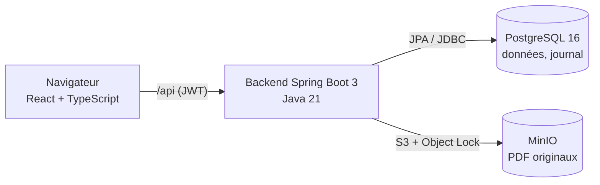
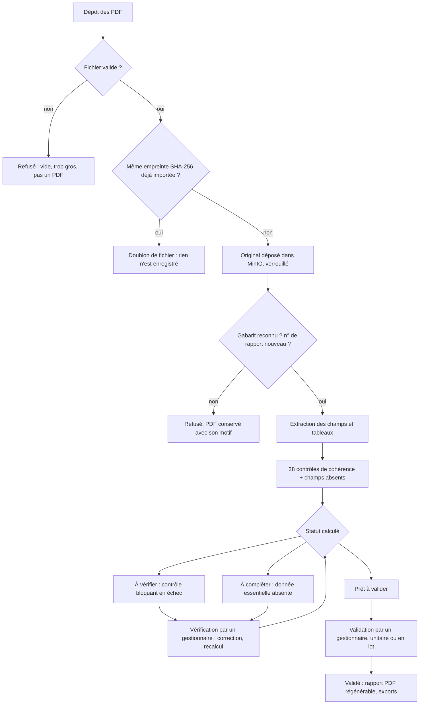

# Architecture

## Vue d'ensemble

- **Frontend** : application React (Vite) ; en développement, Vite relaie `/api` vers le backend (port 8080).
- **Backend** : API REST sans état, authentifiée par jeton JWT ; extraction des PDF, contrôles, génération.
- **PostgreSQL** : toutes les données ; schéma géré uniquement par Flyway (`backend/src/main/resources/db/migration`).
- **MinIO** : PDF originaux, stockés une fois et verrouillés (Object Lock) : ils ne peuvent être ni modifiés ni
  supprimés (P1). Repli possible sur un dossier disque (`lt.stockage.type=disque`).

Tout tourne sur le serveur du cabinet ; les ports de développement ne sont publiés que sur `127.0.0.1` (P11).

## Parcours d'un rapport

Chaque étape est tracée dans le journal d'audit (P7).

## Backend — `backend/src/main/java/ma/ltexpertise`

| Paquet | Rôle | Classes clés |
|---|---|---|
| `importation` | Import des PDF (F1) : contrôle du fichier, doublons (P2), stockage de l'original (P1), lots traités en arrière-plan | `ServiceImport`, `ServiceLotImport`, `AnalyseurGabarit`, `ConversionRapportExtrait`, `ImportController` |
| `extraction` | Lecture du PDF (F2, F3) : mots avec leurs coordonnées (PDFBox), regroupés en lignes, analysés selon le gabarit « tcpdf-expertise-v1 » ; valeurs clés du commentaire (F12) | `PdfMotsExtractor`, `ParseurTcpdfExpertiseV1`, `RapportExtrait`, `ExtracteurCommentaire` |
| `controle` | Contrôles de cohérence (P4, P5), montant en lettres, calcul du statut | `ControleCoherenceService`, `MontantEnLettres`, `Controle` |
| `dossier` | Agrégat dossier (entité `RapportExpertise` et ses enfants), recherche (F7), fiche (F8), modification (F5), validation unitaire et en lot (P3) | `ServiceDossier`, `CriteresRecherche`, `DossierController`, `DossierDtos` |
| `dossier.referentiel` | Énumérations métier (P8) : statuts, postes, zones de choc 1–8, types de pièces… | `StatutDossier`, `ZoneChoc`, `CleCommentaire` |
| `statistiques` | Tableau de bord (F10), analyse des prix | `ServiceStatistiques` |
| `generation` | Rapport PDF régénéré (F9, P10, JasperReports), exports Excel (Apache POI), historique | `RapportPdf`, `ServiceRapports`, `ServiceExports`, `ClasseurExcel` |
| `audit` | Journal d'audit en ajout seul (P7), consultation et export | `JournalAudit`, `JournalController` |
| `securite` | Connexion, jetons, verrouillage des comptes (F11, §8) | `ServiceAuthentification`, `ServiceJetons`, `ConfigurationSecurite` |
| `utilisateur` | Comptes et rôles, gérés par l'administrateur | `ServiceUtilisateurs`, `UtilisateurCourant` |
| `stockage` | Stockage des originaux : MinIO (Object Lock) ou disque | `StockageMinio`, `StockageDisque` |
| `commun` | Montants (HT/TVA/TTC), empreintes SHA-256, horloge | `Montants`, `Empreintes` |

Migrations Java : `backend/src/main/java/db/migration` (calculs impossibles en SQL, ex. V8).

### Extraction

1. `PdfMotsExtractor` lit chaque mot avec sa position (x, y) ; les mots sont regroupés en lignes.
2. `AnalyseurGabarit` vérifie que le PDF est un rapport du logiciel de l'expert et lit son n° (doublons).
3. `ParseurTcpdfExpertiseV1` lit la page 1 par blocs (en-tête, parties, contrat, véhicule, tableau, conclusion),
   repère les étiquettes et lit les valeurs à leur droite ; la page 2 par colonnes calculées sur l'en-tête du
   tableau. Une valeur masquée (« XXXX ») ou absente vaut `null` et figure dans les champs absents.
4. `ExtracteurCommentaire` lit les valeurs clés du commentaire (phrases types des rapports 2026).
5. Tout modèle de PDF non reconnu est refusé proprement : aucune donnée fausse n'est enregistrée.

Le prototype Python validé (`docs/reference/extracteur_rapport.py`) reste la référence de l'extraction.

### Génération

- **PDF** (`RapportPdf`) : modèle JasperReports 7 dessiné en Java (pas de fichier JRXML), compilé au premier
  usage ; police DejaVu Sans embarquée. Page 1 = page de garde ; détail par zone et famille, commentaire.
- **Excel** (`ClasseurExcel`) : écriture en flux (SXSSF), adaptée à des dizaines de milliers de lignes.

## Frontend — `frontend/src`

| Dossier | Contenu |
|---|---|
| `app/` | Routeur (`routes.ts` : adresses et rôles par écran), mise en page (barre latérale, barre du haut) |
| `features/<module>/` | Un dossier par écran : `dashboard`, `imports`, `dossiers` (liste, fiche, vérification), `analyse-prix`, `generation`, `utilisateurs`, `auth` |
| `api/` | Appels typés à l'API (`client.ts` : jeton en mémoire, rafraîchissement automatique ; `exports.ts` : téléchargements) |
| `domain/` | Types miroirs des DTO et énumérations du backend, mise en forme (montants, dates) |
| `components/ui`, `components/charts` | Composants partagés (boutons, tableaux, graphiques Recharts) |
| `test/` | API simulée et rendu de l'application pour les tests Vitest |

Données serveur gérées par TanStack Query ; formulaires par react-hook-form + zod ; style en CSS sur mesure
(maquette Figma, `index.css`).

## Sécurité

- **Connexion** : identifiant + mot de passe (BCrypt). Après 5 échecs, compte verrouillé 15 minutes.
- **Jeton d'accès** : JWT HS256 de 10 minutes, gardé en mémoire dans le navigateur (jamais dans le stockage local),
  envoyé dans l'en-tête `Authorization`.
- **Session** : jeton de rafraîchissement opaque dans un cookie HttpOnly, `SameSite=Strict`, limité à `/api/auth` ;
  renouvelé à chaque usage ; déconnexion après 30 minutes d'inactivité, session de 10 heures au plus. Seule son
  empreinte est stockée en base. Désactiver un compte ou changer son mot de passe ferme ses sessions.
- **Droits** : vérifiés par le serveur sur chaque appel (`@PreAuthorize`), le frontend ne fait que masquer.

| Rôle | Peut |
|---|---|
| Administrateur | Gérer les comptes, consulter et exporter le journal d'audit, consulter dossiers et statistiques |
| Gestionnaire | Importer, vérifier, modifier, valider (unitaire et en lot), générer et exporter |
| Consultation | Consulter dossiers et statistiques, générer le PDF et exporter |
