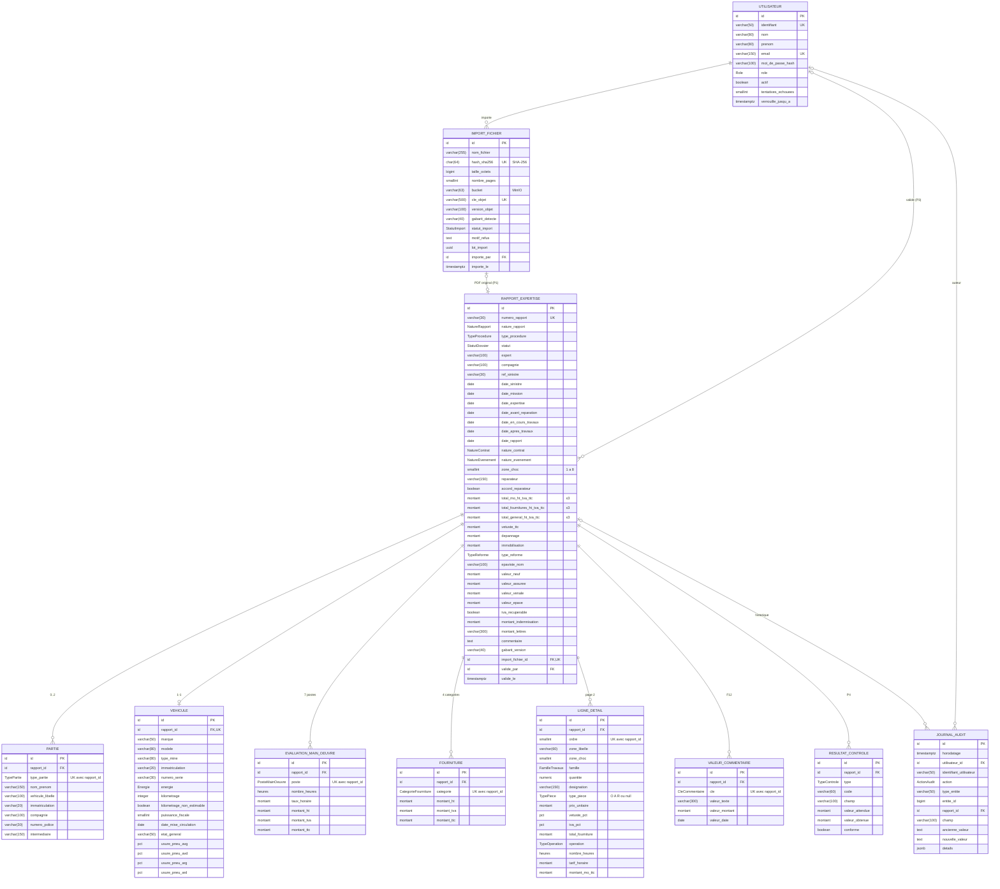

# Modèle de données — proposition v1 (à valider)

Sources : cahier des charges §2, §4 (P1–P11), §6 (F1–F14), extracteur de référence
`docs/reference/extracteur_rapport.py` et analyse des 25 PDF de `samples/`
(6 classiques, 6 PEC + de 20 000, 7 + de 20 000, 2 prise en charge, 4 Wafa 24).

Visualisation : ouvrir `modele-donnees.html` dans un navigateur (diagramme UML + ER).
Source UML : `modele-donnees.puml` (PlantUML).

## 0. Conventions

| Alias        | Type PostgreSQL        | Java          | Usage                                     |
|--------------|------------------------|---------------|-------------------------------------------|
| `montant`    | `numeric(12,2)`        | `BigDecimal`  | tout montant en dirhams (jamais `double`) |
| `pct`        | `numeric(5,2)`         | `BigDecimal`  | vétusté %, TVA %, usure pneus %           |
| `heures`     | `numeric(7,2)`         | `BigDecimal`  | nombre d'heures de main d'œuvre           |
| `id`         | `bigint` identity      | `Long`        | clé primaire technique                    |
| `horodatage` | `timestamptz`          | `OffsetDateTime` | dates techniques                       |
| énumération  | `varchar(40)` + `CHECK`| `enum` + `@Enumerated(STRING)` | jamais l'ordinal          |

- Tables et colonnes en `snake_case` français ; entités Java en `PascalCase`.
- Valeur « NC », « XXXX » ou vide dans le PDF → `NULL` (champ signalé « à compléter » s'il est obligatoire).
- Colonnes d'audit sur les tables métier : `cree_le`, `cree_par`, `modifie_le`, `modifie_par`, `version` (verrou optimiste).
- Schéma créé uniquement par migrations Flyway.

## 1. Énumérations

| Énumération | Valeurs | Origine |
|---|---|---|
| **StatutDossier** | `EN_COURS`, `IMPORTE`, `A_COMPLETER`, `A_VERIFIER`, `VALIDE`, `ARCHIVE` | P6 |
| **TypeProcedure** | `PROCEDURE_CLASSIQUE` (« Procedure classique »), `PRISE_EN_CHARGE_ET_PLUS_QUE_20000` (« PEC et Plus que 20 000 »), `PLUS_DE_20000` (« Plus de 20000 »), `PRISE_EN_CHARGE` (« Prise En Charge »), `WAFA_24` (« Wafa 24 heures ») | ligne sous le titre, p.1 |
| **TypePiece** | `ORIGINE` (O), `ADAPTABLE` (A), `REEMPLOI` (R) — nullable (lignes MO, PP ET ING…) | P8, colonne « Type » p.2 |
| **NatureRapport** 🆕 | `DEFINITIF`, `NON_DEFINITIF`, `REFORME` | titre « RAPPORT D'EXPERTISE [NON DEFINITIF \| REFORME] » |
| **PosteMainOeuvre** | `MO_1_TOLERIE`, `MO_2_TOLERIE`, `MO_3_TOLERIE`, `MO_PEINTURE`, `MO_1_MECANIQUE`, `MO_2_MECANIQUE`, `MO_3_MECANIQUE` (chaque valeur porte sa `FamilleTravaux`) | P8, tableau p.1 |
| **FamilleTravaux** | `TOLERIE`, `PEINTURE`, `MECANIQUE` | P8, sections « · Tolerie » p.2 |
| **CategorieFourniture** | `PIECES`, `INGREDIENT_PEINTURE`, `PETITE_FOURNITURE`, `AUTRES` | tableau p.1 |
| **TypeOperation** | `ECHANGE`, `REPARATION` | colonne p.2 |
| **NatureContrat** | `RC`, `ASSURANCE_DOMMAGE` (seules valeurs vues : 16 / 9) | P8 |
| **ZoneChoc** | `1` Avant/Latéral gauche, `2` Avant/Latéral droit, `3` Central/Latéral gauche *(déduit)*, `4` Central/Latéral droit, `5` Arrière/Latéral gauche, `6` Arrière/Latéral droit, `7` Arrière, `8` Avant | P8 (codes 1 à 8) |
| **NatureEvenement** 🆕 | `CIRCULATION_HORS_STATIONNEMENT`, `STATIONNEMENT`, `AUTRE` | champ « N.E » p.1 |
| **TypeReforme** | `ECONOMIQUE`, `TECHNIQUE` | « Réforme Economique( ) Technique( ) » |
| **Energie** | `ESSENCE`, `DIESEL`, `HYBRIDE`, `ELECTRIQUE`, `AUTRE` | p.1 |
| **TypePartie** | `ASSURE`, `ADVERSAIRE` | bloc p.1 |
| **Role** | `ADMINISTRATEUR`, `GESTIONNAIRE`, `CONSULTATION` | F11, P9 |
| **StatutImport** | `ACCEPTE`, `REFUSE_GABARIT`, `REFUSE_DOUBLON_NUMERO`, `ERREUR_LECTURE` | F1, §3 |
| **ActionAudit** | `CONNEXION`, `ECHEC_CONNEXION`, `IMPORT`, `IMPORT_REFUSE`, `CREATION`, `MODIFICATION`, `CHANGEMENT_STATUT`, `VALIDATION`, `ARCHIVAGE`, `EXPORT_PDF`, `EXPORT_EXCEL`, `GESTION_UTILISATEUR` | P7 |
| **TypeControle** | `COHERENCE`, `CHAMP_MANQUANT` | F4 |
| **CleCommentaire** 🆕 | `VALEUR_NEUF_CATALOGUE`, `VALEUR_VENALE_FMA`, `MONTANT_DEVIS`, `ESTIMATION_SANS_DEVIS`, `CADRE_EXPERTISE` (CLASSIQUE/FORFAITAIRE), `LOCALISATION_CHOC`, `EXPERT_CONFRERE`, `MODE_EXPERTISE_CONFRERE` (CONTRADICTOIRE/COLLEGIALE), `DATE_ACCORD`, `DIVERGENCE_USAGE` — liste à valider avec LT Expertise (F12) | commentaires 2026 |

✅ Décidé : `TypeProcedure` pour les 5 procédures ; `TypePiece` = O / A / R (P8).

## 2. Entités

### 2.1 RapportExpertise — `rapport_expertise` (le dossier)

| Colonne | Type | Contraintes / remarques |
|---|---|---|
| id | id | PK |
| numero_rapport | varchar(30) | **UNIQUE** (P2). NULL autorisé seulement pour `EN_COURS` (F14). Formats vus : `268202-3166`, `5576wca025` (non définitif) |
| nature_rapport | NatureRapport | NOT NULL, défaut `DEFINITIF` |
| type_procedure | TypeProcedure | NOT NULL sauf `EN_COURS` |
| statut | StatutDossier | NOT NULL, indexé |
| cabinet | varchar(100) | |
| expert | varchar(100) | indexé (F13 « par expert ») |
| compagnie | varchar(100) | « Assurance : » de l'en-tête, indexé |
| ref_sinistre | varchar(30) | indexé (recherche F7, rapprochement F14) |
| date_sinistre | date | contrôle : ≤ date_mission (ex. `23/12/1925` vu dans B1) |
| date_mission | date | début du délai F13 |
| date_expertise | date | « Date expertise véhicule » |
| date_avant_reparation | date | |
| date_en_cours_travaux | date | |
| date_apres_travaux | date | |
| date_rapport | date | « Fait à … le » — fin du délai F13, indexé |
| lieu_rapport | varchar(60) | « Casablanca » |
| nature_contrat | NatureContrat | |
| nature_evenement | NatureEvenement | champ N.E |
| zone_choc | smallint | `CHECK (zone_choc BETWEEN 1 AND 8)`, indexé |
| reparateur | varchar(150) | indexé (recherche F7) |
| accord_reparateur | boolean | Oui (X) / Non (X) |
| total_mo_ht / total_mo_tva / total_mo_ttc | montant | « Total main d'oeuvre » tel que lu (contrôlé P4) |
| total_fournitures_ht / _tva / _ttc | montant | « Total fournitures (Dh) » |
| total_general_ht / _tva / _ttc | montant | « Total général » |
| vetuste_ttc | montant | « A déduire / Vétusté TTC » |
| depannage | montant | |
| immobilisation | montant | toujours vide dans les échantillons — voir question 6 |
| type_reforme | TypeReforme | NULL si pas de réforme |
| epaviste_nom | varchar(100) | « Epaviste retenu » (rapports REFORME) |
| epaviste_ville | varchar(60) | |
| valeur_neuf / valeur_assuree / valeur_venale / valeur_epave | montant | NULL si « NC » |
| tva_recuperable | boolean | NOT NULL — P5 (HT si récupérable, TTC sinon) |
| montant_indemnisation | montant | NOT NULL sauf `EN_COURS`, `CHECK (>= 0)`, indexé (tranches F7) |
| montant_lettres | varchar(300) | contrôlé P4 (centimes gérés) |
| commentaire | text | texte intégral toujours conservé (F12) |
| gabarit_version | varchar(40) | ex. `tcpdf-expertise-v1` |
| import_fichier_id | FK → import_fichier | **UNIQUE**, NULL si saisi depuis Excel (F14) |
| valide_par | FK → utilisateur | P3 : rôle GESTIONNAIRE vérifié côté service |
| valide_le | horodatage | |
| cree_le, cree_par, modifie_le, modifie_par, version | audit | |

Contraintes de table :
- `CHECK (statut <> 'VALIDE' OR (valide_par IS NOT NULL AND valide_le IS NOT NULL))` — P3.
- `CHECK (statut = 'EN_COURS' OR numero_rapport IS NOT NULL)`.
- `CHECK (type_reforme IS NULL OR nature_rapport = 'REFORME')`.
- Tous les montants `>= 0`.

Règle P4 selon la nature (vérifiée sur les échantillons) :
- `DEFINITIF` : `total_general_ttc − vetuste_ttc = montant_indemnisation` (ex. 62 823,30 − 12 606,37 = 50 216,93).
- `REFORME` : `valeur_venale − valeur_epave = montant_indemnisation` (3/3 : 80 000 − 23 000 = 57 000 ; 70 000 − 63 500 = 6 500 ; 95 000 − 28 000 = 67 000), tableau p.2 vide.

### 2.2 Partie — `partie` (assuré / adversaire)

| Colonne | Type | Contraintes |
|---|---|---|
| id | id | PK |
| rapport_id | FK → rapport_expertise | NOT NULL, `ON DELETE CASCADE` |
| type_partie | TypePartie | NOT NULL ; **UNIQUE (rapport_id, type_partie)** |
| nom_prenom | varchar(150) | souvent masqué → « à compléter » (donnée personnelle, loi 09-08) |
| vehicule_libelle | varchar(100) | « HYUNDAI TUCSON » tel qu'affiché |
| immatriculation | varchar(20) | indexé (recherche F7) |
| compagnie | varchar(100) | |
| numero_police | varchar(30) | peut être masqué (`08********`) ou `0` |
| intermediaire | varchar(150) | |

Cardinalité : 0..2 par rapport (0 pour un dossier `EN_COURS`, l'adversaire est souvent vide).

### 2.3 Vehicule — `vehicule` (véhicule expertisé, instantané par rapport)

| Colonne | Type | Contraintes |
|---|---|---|
| id | id | PK |
| rapport_id | FK → rapport_expertise | NOT NULL, **UNIQUE** (1–1), `ON DELETE CASCADE` |
| marque | varchar(50) | |
| modele | varchar(80) | |
| type_mine | varchar(80) | |
| immatriculation | varchar(20) | indexé |
| numero_serie | varchar(30) | VIN |
| energie | Energie | |
| kilometrage | integer | `CHECK (>= 0)` ; NULL si « Non Estimable » |
| kilometrage_non_estimable | boolean | défaut false |
| puissance_fiscale | smallint | |
| date_mise_circulation | date | « D.M.C » |
| etat_general | varchar(50) | « Normal » |
| usure_pneu_avg / _avd / _arg / _ard | pct | `CHECK (BETWEEN 0 AND 100)` |

### 2.4 EvaluationMainOeuvre — `evaluation_main_oeuvre` (7 lignes par rapport)

| Colonne | Type | Contraintes |
|---|---|---|
| id | id | PK |
| rapport_id | FK | NOT NULL, CASCADE |
| poste | PosteMainOeuvre | NOT NULL ; **UNIQUE (rapport_id, poste)** |
| nombre_heures | heures | `>= 0` |
| taux_horaire | montant | « Prix unitaire », `>= 0` (alerte écart au taux habituel) |
| montant_ht / montant_tva / montant_ttc | montant | P4 : heures × taux = HT ; HT + TVA = TTC |

### 2.5 Fourniture — `fourniture` (4 lignes par rapport)

| Colonne | Type | Contraintes |
|---|---|---|
| id | id | PK |
| rapport_id | FK | NOT NULL, CASCADE |
| categorie | CategorieFourniture | NOT NULL ; **UNIQUE (rapport_id, categorie)** |
| montant_ht / montant_tva / montant_ttc | montant | somme = total_fournitures_* (P4) |

### 2.6 LigneDetail — `ligne_detail` (tableau « Détail fournitures / travaux », p.2)

| Colonne | Type | Contraintes |
|---|---|---|
| id | id | PK |
| rapport_id | FK | NOT NULL, CASCADE |
| ordre | smallint | **UNIQUE (rapport_id, ordre)** — restitue l'ordre du PDF (P10) |
| zone_libelle | varchar(60) | section « Avant/Lateral gauche » |
| zone_choc | smallint | 1–8, déduit du libellé |
| famille | FamilleTravaux | section « · Tolerie / Peinture / Mecanique » |
| quantite | numeric(8,2) | `> 0` (ex. 84 rivets) |
| designation | varchar(150) | NOT NULL |
| type_piece | TypePiece | nullable |
| prix_unitaire | montant | |
| vetuste_pct | pct | |
| tva_pct | pct | 0 ou 20 observés |
| total_fourniture | montant | colonne « Total » (TTC) |
| operation | TypeOperation | Echange / Réparation |
| nombre_heures | heures | partie « Travaux de réparation » |
| tarif_horaire | montant | |
| montant_mo_ttc | montant | |

P4 page 1 = page 2 : Σ total_fourniture = total_fournitures_ttc ; Σ montant_mo_ttc = total_mo_ttc.

### 2.7 ImportFichier — `import_fichier` (PDF importés, y compris refusés)

| Colonne | Type | Contraintes |
|---|---|---|
| id | id | PK |
| nom_fichier | varchar(255) | NOT NULL |
| hash_sha256 | char(64) | NOT NULL, **UNIQUE** (P2, F1) — `CHECK (hash_sha256 ~ '^[0-9a-f]{64}$')` |
| taille_octets | bigint | `> 0` (contrôle de taille) |
| nombre_pages | smallint | |
| bucket | varchar(63) | NOT NULL — bucket MinIO, ex. `rapports-originaux` |
| cle_objet | varchar(500) | NOT NULL, **UNIQUE** — clé dérivée du hash : `originaux/{hash[0..2]}/{hash}.pdf` |
| version_objet | varchar(100) | identifiant de version MinIO (bucket versionné) |
| type_mime | varchar(100) | NOT NULL, `application/pdf` vérifié à l'import |
| gabarit_detecte | varchar(40) | NULL si non reconnu |
| statut_import | StatutImport | NOT NULL |
| motif_refus | text | obligatoire si statut ≠ ACCEPTE |
| lot_import | uuid | import en lot (récapitulatif) |
| importe_par | FK → utilisateur | NOT NULL |
| importe_le | horodatage | NOT NULL |
| retraite_le | horodatage | réimport en un clic après ajout du gabarit |

- Un fichier strictement identique (même hash) n'est **pas** réinséré : la tentative est tracée dans `journal_audit` (`IMPORT_REFUSE`).
- Un fichier différent mais au n° de rapport déjà connu est conservé avec `REFUSE_DOUBLON_NUMERO`.
- La liste « Fichiers refusés » = `statut_import <> 'ACCEPTE'`.

**Stockage des PDF : MinIO (décidé)**
- MinIO auto-hébergé en conteneur Docker sur le serveur du cabinet, à côté de PostgreSQL : aucun service cloud, conforme à P11 et à la loi 09-08.
- Bucket `rapports-originaux` versionné, avec **Object Lock** (mode GOVERNANCE) : le PDF original ne peut être ni écrasé ni supprimé par l'application (P1).
- La base ne stocke que la référence (bucket, clé, version) et le hash. Le hash est recalculé à la lecture pour vérifier l'intégrité.
- Ordre d'écriture à l'import : objet MinIO d'abord, puis ligne `import_fichier`. Une tâche de nettoyage supprime les objets sans ligne en base, en cas d'échec entre les deux.
- L'accès passe uniquement par l'API Spring (droits vérifiés, P9). MinIO n'est jamais exposé aux postes clients.
- Sauvegarde quotidienne : `pg_dump` + `mc mirror` du bucket vers le disque séparé, conservée 30 jours.
- Verrou par objet : *legal hold* (sans durée, levable seulement par un administrateur MinIO) plutôt qu'une rétention à durée fixe.
- ⚠️ Image Docker : le dépôt Docker Hub `minio/minio` a été supprimé par MinIO (édition communautaire en source seule).
  L'image utilisée est une copie en cache retaguée `lt-expertise/minio:RELEASE.2025-09-07T16-13-09Z`.
  Source durable à décider avant la mise en service (voir question 10).

Implémenté (22/10/2026) : `ServiceImport`, `StockageMinio`, `POST /api/imports`, `GET /api/imports[?refuses=true]`,
`GET /api/imports/{id}/pdf`. Gabarit : au moins 2 pages (un échantillon réel en compte 3).

### 2.8 Utilisateur — `utilisateur`

| Colonne | Type | Contraintes |
|---|---|---|
| id | id | PK |
| identifiant | varchar(50) | NOT NULL, **UNIQUE** |
| nom, prenom | varchar(80) | NOT NULL |
| email | varchar(150) | UNIQUE, nullable |
| mot_de_passe_hash | varchar(100) | NOT NULL (BCrypt) |
| role | Role | NOT NULL (un rôle par utilisateur) |
| actif | boolean | défaut true (désactivation plutôt que suppression, pour l'audit) |
| tentatives_echouees | smallint | défaut 0 — verrouillage à 5 |
| verrouille_jusqu_a | horodatage | |
| derniere_connexion | horodatage | |
| cree_le, modifie_le | horodatage | |

### 2.9 JournalAudit — `journal_audit` (append-only)

| Colonne | Type | Contraintes |
|---|---|---|
| id | id | PK |
| horodatage | horodatage | NOT NULL, défaut `now()`, indexé |
| utilisateur_id | FK → utilisateur | nullable (échec de connexion) |
| identifiant_utilisateur | varchar(50) | copie figée (lisible même si le compte change) |
| action | ActionAudit | NOT NULL |
| type_entite | varchar(50) | `RapportExpertise`, `LigneDetail`… |
| entite_id | bigint | |
| rapport_id | FK → rapport_expertise | nullable, indexé — historique d'un dossier (F5) |
| champ | varchar(100) | une ligne par champ modifié |
| ancienne_valeur | text | |
| nouvelle_valeur | text | |
| details | jsonb | contexte (filtres d'un export, nb de lignes…) |
| adresse_ip | varchar(45) | |

Aucune mise à jour ni suppression : droits `INSERT, SELECT` seulement pour l'utilisateur applicatif (ou trigger de refus).

### 2.10 Ajouts proposés (hors liste demandée)

**ValeurCommentaire — `valeur_commentaire`** (F12, rapports 2026)
`id`, `rapport_id` FK CASCADE, `cle` CleCommentaire, `valeur_texte varchar(300)`,
`valeur_montant montant`, `valeur_date date` ; **UNIQUE (rapport_id, cle)**.
Clé/valeur plutôt que colonnes : la liste exacte des valeurs n'est pas encore arrêtée
avec le cabinet, et elle reste filtrable et utilisable dans les statistiques.

**ResultatControle — `resultat_controle`** (F4, F5, alertes d'anomalies)
`id`, `rapport_id` FK CASCADE, `type` TypeControle, `code varchar(60)`, `libelle varchar(200)`,
`champ varchar(100)`, `valeur_attendue montant`, `valeur_obtenue montant`, `conforme boolean`,
`execute_le horodatage`. Recalculé à chaque modification ; sert à surligner les champs
en erreur et à lister les dossiers en anomalie.

**Plus tard (non modélisé ici)** : `parametre_application` (délai cible F13, taux horaire
habituel), `synchronisation_excel` + correspondance de colonnes (F14).

## 3. Diagramme

## 4. Constats sur les échantillons et questions à trancher

1. ✅ **Nom de l'énumération** : `TypeProcedure` pour les procédures, `TypePiece` = O/A/R.
2. **NatureRapport** : 3 rapports « REFORME » et 1 « NON DEFINITIF » (A_rapport6 : n° `5576wca025`, indemnisation 0,00, sans date). On ajoute l'énumération ? Un non définitif peut-il passer à `VALIDE`, ou doit-il rester bloqué jusqu'au définitif (qui remplacerait alors le même dossier) ?
3. **Zone 3** : libellé « Central/Latéral gauche » déduit (aucun échantillon). À confirmer.
4. **NatureContrat** : seules `RC` et `ASSURANCE DOMMAGE` apparaissent. Y en a-t-il d'autres (tous risques…) ?
5. ✅ **Véhicule** : un véhicule par rapport (1–1).
6. **Immobilisation** : toujours vide. Est-ce un montant ou un nombre de jours ?
7. ✅ **PDF** : stockés dans MinIO local (voir 2.7), référence + hash en base.
8. **Qualité des données** vues : date sinistre `23/12/1925` (B1), kilométrage/énergie décalés par la mise en page (« GLC220 », « CLIO » à la place du km/énergie), n° police masqué. On ajoute un contrôle « dates cohérentes » (sinistre ≤ mission ≤ expertise ≤ rapport) ?
9. **Compagnie / réparateur / expert** : texte libre (recommandé pour la v1) ou référentiels dédiés pour fiabiliser les statistiques ?
10. **Image MinIO durable** : construire l'image depuis les sources MinIO (AGPL), utiliser un fork maintenu, ou garder l'image en cache archivée (`docker save`) pour l'installation chez LT Expertise ?
